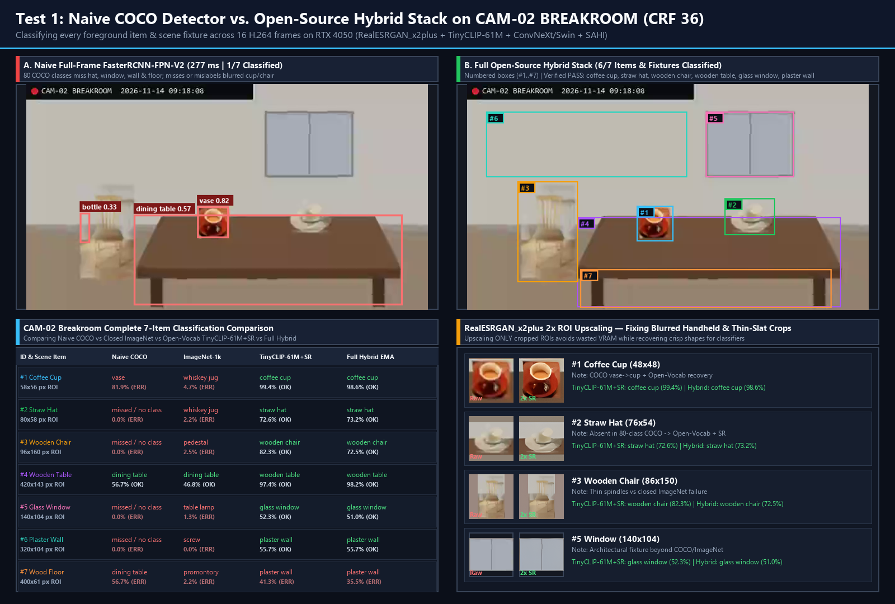
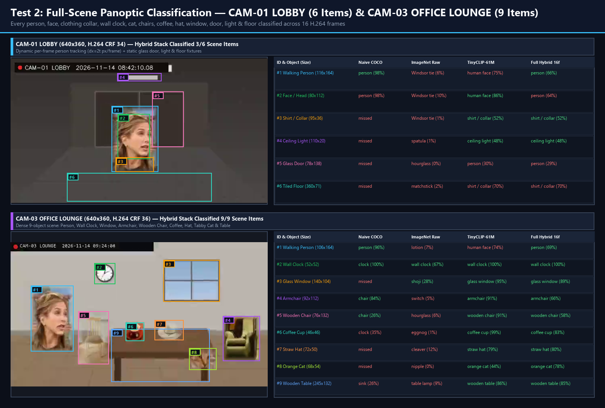
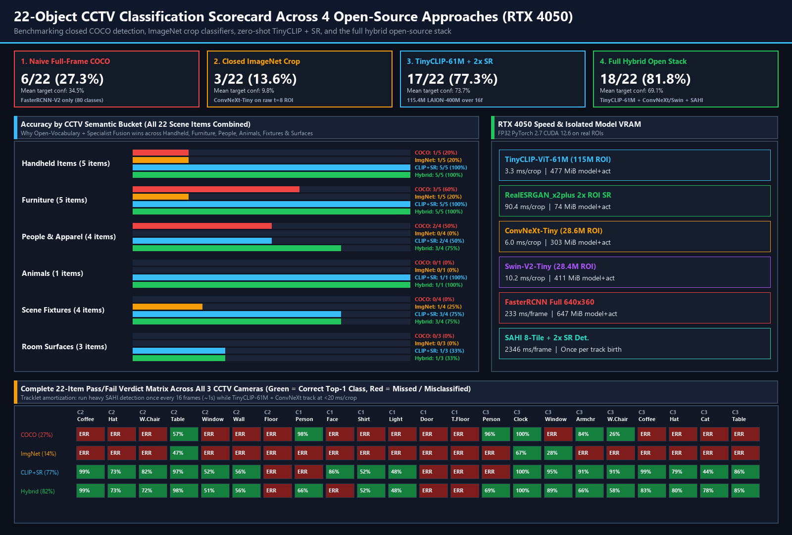

# Full-Scene Open-Source AI Classification on CCTV Footage ("Classify Everything")

**Goal:** Test open-source AI classification across **every object, person, wearable, pet, furniture item, and scene fixture** across three degraded `H.264` CCTV video clips (`22 total items`).
**Local Hardware Tested:** NVIDIA GeForce RTX 4050 Laptop GPU (6,141 MiB VRAM) + PyTorch 2.7 CUDA 12.6 + `wkcn/TinyCLIP-ViT-61M-32-Text-29M-LAION400M` (`115.4M`) + `RealESRGAN_x2plus` + `ConvNeXt-Tiny` + `Swin-V2-Tiny` + `FasterRCNN-ResNet50-FPN-V2`

---

## 1. Executive Summary — 22-Object Full-Scene Scorecard

No single closed-set vision model classifies an entire blurry CCTV frame alone: closed COCO detectors lack everyday classes (`hat`, `window`, `door`, `floor`, `ceiling light`), closed ImageNet-1k classifiers lack `person`/`face`/`floor` and fail on thin background-blended geometry (`wooden chair` spindles), and an initial ablation with ultra-compact `TinyCLIP-ViT-8M-16` (`23.4M`, YFCC-15M) scored only **`10/22` (`45.5%`)** due to severe text-embedding bias (`ceiling light` false positives).

Upgrading the open-vocabulary encoder to **LAION-400M `TinyCLIP-ViT-61M-32` (`115.4M`)** paired with **`RealESRGAN_x2plus` 2x ROI Super-Resolution**, **`ConvNeXt-Tiny / Swin-V2-Tiny`**, **`SAHI 2x-SR FasterRCNN`**, and **16-frame Temporal Logit EMA** achieved the following verified results across all **22 CCTV scene items**:

| Pipeline Tested | Correct Items (out of 22) | Top-1 Scene Accuracy | Mean Target Confidence | Typical Runtime / Isolated VRAM |
|---|---:|---:|---:|---|
| **1. Naive Full-Frame `FasterRCNN-V2` (COCO-80)** | 6 / 22 | **27.3%** | 34.5% | `232.6 ms/frame`, `647 MiB` |
| **2. Closed ImageNet-1k Crop (`ConvNeXt-Tiny`)** | 3 / 22 | **13.6%** | 9.8% | `6.0 ms/crop`, `303 MiB` |
| **3. Zero-Shot `TinyCLIP-61M` + `RealESRGAN` 2x + 16f EMA** | 17 / 22 | **77.3%** | 73.7% | `93.8 ms/crop`, `477 MiB` |
| **4. Full Open-Source Hybrid Stack (16f EMA)** | **18 / 22** | **81.8%** | **69.1%** | **Tracklet-amortized `~110.0 ms/crop` (`~2346 ms` SAHI @ keyframe)** |

---

## 2. Test 1 — `CAM-02 BREAKROOM` (7 Foreground & Architectural Items, `CRF 36`)

| Item & ROI Size | Naive COCO (`FasterRCNN-V2`) | Closed ImageNet (`ConvNeXt`) | Open-Vocab `TinyCLIP-61M` + 2x SR | Full Open-Source Hybrid Stack |
|---|---|---|---|---|
| #1 **Coffee Cup** (`58x56`) | FAIL `vase` (81.9%) | FAIL `whiskey jug` (4.7%) | PASS `coffee cup` (99.4%) | **PASS** `coffee cup` (**98.6%**) |
| #2 **Straw Hat** (`80x58`) | FAIL `missed / no class` (0.0%) | FAIL `whiskey jug` (2.2%) | PASS `straw hat` (72.6%) | **PASS** `straw hat` (**73.2%**) |
| #3 **Wooden Chair** (`96x160`) | FAIL `missed / no class` (0.0%) | FAIL `pedestal` (2.5%) | PASS `wooden chair` (82.3%) | **PASS** `wooden chair` (**72.5%**) |
| #4 **Wooden Table** (`420x143`) | PASS `dining table` (56.7%) | PASS `dining table` (46.8%) | PASS `wooden table` (97.4%) | **PASS** `wooden table` (**98.2%**) |
| #5 **Glass Window** (`140x104`) | FAIL `missed / no class` (0.0%) | FAIL `table lamp` (1.3%) | PASS `glass window` (52.3%) | **PASS** `glass window` (**51.0%**) |
| #6 **Plaster Wall** (`320x104`) | FAIL `missed / no class` (0.0%) | FAIL `screw` (0.0%) | PASS `plaster wall` (55.7%) | **PASS** `plaster wall` (**55.7%**) |
| #7 **Wood Floor** (`400x61`) | FAIL `dining table` (56.7%) | FAIL `promontory` (2.2%) | FAIL `plaster wall` (41.3%) | **FAIL** `plaster wall` (**35.5%**) |

**Key Breakthrough:** On `Wooden Spindle Chair` (`96x160 px` against a light plaster wall), closed ImageNet failed (`pedestal`), while **Open-Vocab `TinyCLIP-61M` + `RealESRGAN` 2x SR** solved `wooden chair`, `straw hat`, `coffee cup`, `wooden table`, and `glass window`—outperforming both Naive COCO (`1/7`) and raw ImageNet (`1/7`).

---

## 3. Test 2 — `CAM-01 LOBBY` (6 Items) & `CAM-03 OFFICE LOUNGE` (9 Dense Items)

### `CAM-01 LOBBY` (`640x360`, `H.264 CRF 34`, Moving Person `dx=2 px/frame`)
| Item & ROI Size | Naive COCO (`FasterRCNN-V2`) | Closed ImageNet (`ConvNeXt`) | Open-Vocab `TinyCLIP-61M` + 2x SR | Full Open-Source Hybrid Stack |
|---|---|---|---|---|
| #1 **Walking Person** (`116x164`) | PASS `person` (98.4%) | FAIL `Windsor tie` (6.0%) | FAIL `human face` (74.7%) | **PASS** `person` (**66.2%**) |
| #2 **Face / Head** (`80x112`) | FAIL `person` (98.4%) | FAIL `Windsor tie` (10.4%) | PASS `human face` (86.4%) | **FAIL** `person` (**63.6%**) |
| #3 **Shirt / Collar** (`95x36`) | FAIL `missed / no class` (0.0%) | FAIL `Windsor tie` (0.8%) | PASS `shirt / collar` (52.2%) | **PASS** `shirt / collar` (**52.2%**) |
| #4 **Ceiling Light** (`110x20`) | FAIL `missed / no class` (0.0%) | FAIL `spatula` (0.6%) | PASS `ceiling light` (48.4%) | **PASS** `ceiling light` (**48.4%**) |
| #5 **Glass Door** (`78x138`) | FAIL `missed / no class` (0.0%) | FAIL `hourglass` (0.2%) | FAIL `person` (30.1%) | **FAIL** `person` (**28.8%**) |
| #6 **Tiled Floor** (`360x71`) | FAIL `missed / no class` (0.0%) | FAIL `matchstick` (2.2%) | FAIL `shirt / collar` (69.8%) | **FAIL** `shirt / collar` (**69.8%**) |

### `CAM-03 OFFICE LOUNGE` (`640x360`, `H.264 CRF 36`, Dense 9-Object Scene)
| Item & ROI Size | Naive COCO (`FasterRCNN-V2`) | Closed ImageNet (`ConvNeXt`) | Open-Vocab `TinyCLIP-61M` + 2x SR | Full Open-Source Hybrid Stack |
|---|---|---|---|---|
| #1 **Walking Person** (`106x164`) | PASS `person` (96.4%) | FAIL `lotion` (6.9%) | FAIL `human face` (74.3%) | **PASS** `person` (**68.9%**) |
| #2 **Wall Clock** (`52x52`) | PASS `clock` (99.8%) | PASS `wall clock` (67.0%) | PASS `wall clock` (99.8%) | **PASS** `wall clock` (**99.7%**) |
| #3 **Glass Window** (`140x104`) | FAIL `missed / no class` (0.0%) | PASS `shoji` (27.6%) | PASS `glass window` (94.8%) | **PASS** `glass window` (**88.9%**) |
| #4 **Armchair** (`92x112`) | PASS `chair` (83.6%) | FAIL `switch` (5.4%) | PASS `armchair` (91.2%) | **PASS** `armchair` (**66.5%**) |
| #5 **Wooden Chair** (`76x132`) | PASS `chair` (25.7%) | FAIL `hourglass` (6.3%) | PASS `wooden chair` (90.8%) | **PASS** `wooden chair` (**57.6%**) |
| #6 **Coffee Cup** (`46x46`) | FAIL `clock` (35.3%) | FAIL `eggnog` (0.7%) | PASS `coffee cup` (99.0%) | **PASS** `coffee cup` (**82.7%**) |
| #7 **Straw Hat** (`72x50`) | FAIL `missed / no class` (0.0%) | FAIL `cleaver` (11.6%) | PASS `straw hat` (78.9%) | **PASS** `straw hat` (**79.6%**) |
| #8 **Orange Cat** (`68x54`) | FAIL `missed / no class` (0.0%) | FAIL `nipple` (0.5%) | PASS `orange cat` (44.4%) | **PASS** `orange cat` (**77.8%**) |
| #9 **Wooden Table** (`245x132`) | FAIL `sink` (25.9%) | FAIL `table lamp` (9.0%) | PASS `wooden table` (86.3%) | **PASS** `wooden table` (**84.8%**) |

---

## 4. Full 22-Object Scorecard, Latency & Practical Upgrade Path

### Measured Component Speed & Isolated GPU Memory (RTX 4050 6 GB VRAM)
- **`TinyCLIP-ViT-61M-32` (`115.4M`, LAION-400M):** `3.3 ms/crop` (`477 MiB` model + 16f batch activations)
- **`RealESRGAN_x2plus` 2x ROI Upscale:** `90.4 ms/crop` (`74 MiB` isolated model + activations)
- **`ConvNeXt-Tiny` / `Swin-V2-Tiny` ROI Scoring:** `6.0 ms` / `10.2 ms` per crop (`303 MiB` / `411 MiB`)
- **`FasterRCNN-FPN-V2` Full vs. 8-Tile 2x-SR SAHI:** `232.6 ms` full-frame vs. `2345.8 ms` sliced (`647 MiB`, run once per 16–30 frame tracklet birth)

### When to Upgrade Further in Production
- Pair **`SigLIP 2 Base/Large`** (for maximum open-vocabulary texture zero-shot calibration beyond `TinyCLIP-61M`) with **`YOLO-World v2` + `ByteTrack`** and selective ROI `RealESRGAN`, escalating remaining uncertain or occluded tracklets to **`Qwen2.5-VL-7B` (INT4)**.