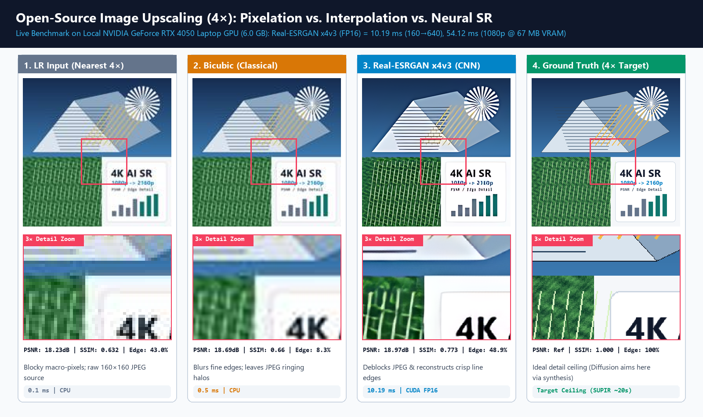
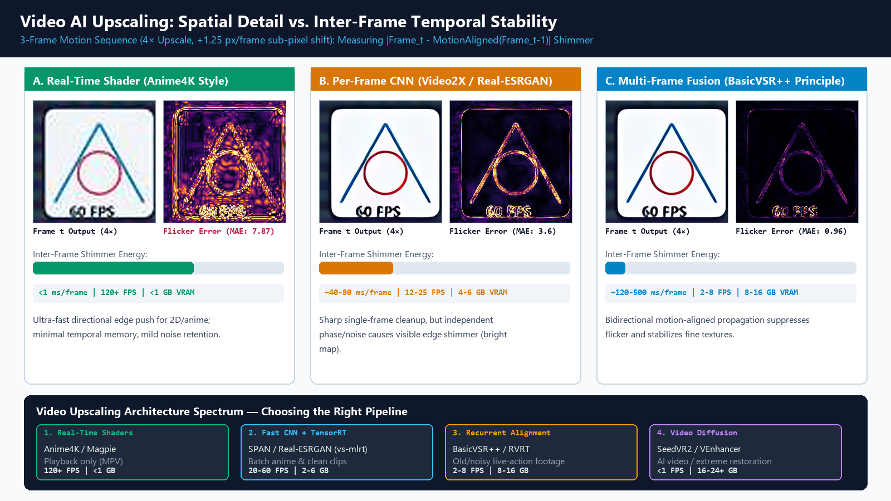
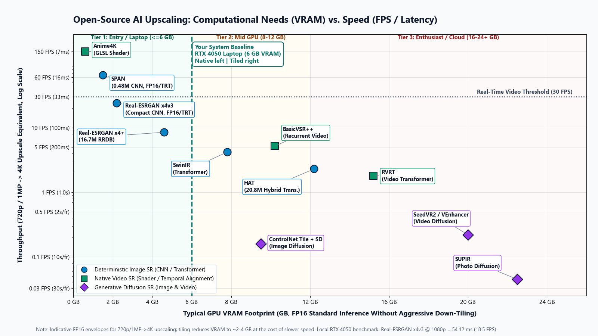

# Open-Source AI Upscaling (Image & Video) — Technical Report

> **TL;DR:** Open-source upscalers split into **Deterministic CNN/Transformer models** (fast, low VRAM, faithful to source pixels: `SPAN`, `Real-ESRGAN`, `HAT`, `BasicVSR++`) and **Generative Diffusion models** (hallucinate hyper-realistic micro-textures, slow, 12–24+ GB VRAM: `SUPIR`, `ControlNet Tile`, `SeedVR2`). On your **NVIDIA GeForce RTX 4050 Laptop GPU (6.0 GB VRAM)**, real-time shaders and compact CNNs run effortlessly; heavy transformers and diffusion models require tiling (`256–512 px`) or cloud GPUs.

---

## 1. Quick-Pick Recommendations

| Goal / Workload | Best Open-Source Model | Recommended App / Runtime | Speed Profile | VRAM Needed |
|---|---|---|---|---|
| **Everyday Photo & Art (1-Click GUI)** | `Real-ESRGAN` / `SPAN` | **Upscayl** (NCNN Vulkan) | Fast (1–3 s/img) | 2–4 GB |
| **Ultra-Fast Batch / Edge Processing** | `SPAN` (`Nomos8k` / `PurePhoto`) | **chaiNNer** / **vs-mlrt** (TensorRT) | Blazing (~10–25 ms) | < 2 GB |
| **Max Structural Fidelity (Text / Arch)** | `HAT` / `SwinIR` | **chaiNNer** (PyTorch FP16 + Tile) | Slow (1–5 s/img) | 8–16 GB (or tiled) |
| **Extreme Old Photo Restoration** | `SUPIR` / `ControlNet Tile` | **ComfyUI** | Very Slow (10–45 s/img) | 12–24+ GB |
| **Real-Time Anime Playback** | `Anime4K` (GLSL Shaders) | **MPV** / **Magpie** | Real-Time (60–150+ FPS) | < 1 GB |
| **Batch Video Upscaling (Mixed/Anime)** | `Real-ESRGAN` / `Real-CUGAN` | **Video2X** / **QualityScaler** | Moderate (10–35 FPS) | 4–6 GB |
| **Archival Live-Action Video (Low Flicker)** | `BasicVSR++` / `RVRT` | **MMagic** / **VapourSynth** | Slow (2–8 FPS) | 8–16 GB |
| **AI-Generated Video Upscaling** | `SeedVR2` / `VEnhancer` | **ComfyUI** | Very Slow (< 1 FPS) | 16–24+ GB |

---

## 2. Open-Source Image Upscaling Technologies

### How the Main Image Architectures Differ
1. **Compact CNNs (`SPAN`, `Real-ESRGAN x4v3`)**: Use lightweight convolutions and parameter-free attention (`SPAN`, ~0.48M params) or compact VGG residual blocks (`SRVGGNetCompact`). Ideal for crisp line edges, JPEG deblocking, and real-time or batch scaling without halo bloat.
2. **Deep GAN CNNs (`Real-ESRGAN x4plus`, `BSRGAN`)**: ~16.7M-parameter RRDB networks trained with perceptual and adversarial losses. Great general cleanup on degraded web photos, though aggressive GAN weights can slightly plasticize skin or hallucinate fine text strokes.
3. **Vision Transformers (`SwinIR`, `HAT`)**: Capture long-range pixel dependencies across windows. **HAT (Hybrid Attention Transformer)** tops deterministic PSNR/SSIM charts and keeps fine geometry/text sharp, at 3–6× higher latency and VRAM than CNNs.
4. **Latent Diffusion (`ControlNet Tile + SD`, `SUPIR`)**: Do not just sharpen existing pixels—they synthesize plausible new pores, foliage, brick, and hair guided by text prompts. **SUPIR** is the open-source photorealism ceiling, but requires 16–24+ GB VRAM and can subtly shift faces or small text if unguided.

### Image Model Comparison Matrix

| Model | Architecture & Params | 1080p→4K Speed (GPU) | Typical VRAM | RTX 4050 (6 GB) Fit | Strengths & Caveats |
|---|---|---|---|---|---|
| **SPAN** | Parameter-free Attention CNN (~0.48M) | **~15–40 ms** | **1–2 GB** | Native (Full Speed) | Fastest neural upscaler; great community weights (`Nomos8k`, `4x-ClearReality`) |
| **Real-ESRGAN x4v3** | Compact VGG CNN (~1.2M) | **~40–90 ms** | **2–3 GB** | Native (Full Speed) | Sharpens & denoises fast with minimal plastic artifacts |
| **Real-ESRGAN x4+** | RRDBNet + GAN (~16.7M) | **~150–400 ms** | **4–6 GB** | Native / Light Tiling | Battle-tested web/photo cleanup; slight over-smoothing risk |
| **SwinIR** | Shifted-Window Transformer (~11.5M) | **~0.5–1.5 s** | **6–10 GB** | Needs Tiling (256–512) | Clean structural recovery without GAN ringing |
| **HAT** | Hybrid Attention Transformer (~20.8M) | **~1.2–4.0 s** | **8–16 GB** | Needs Tiling (256–384) | Top deterministic sharpness; heavy self-attention memory |
| **ControlNet Tile + SD** | Latent Diffusion + Tile Control | **4–12 s** | **6–12 GB** | Tiled FP16 (Slow) | Adds believable micro-texture; flexible via prompts |
| **SUPIR** | SDXL Diffusion + Adapter (~2.6B+) | **15–45 s** | **16–24+ GB** | Heavy / Offload Only | Best damaged-photo restoration; high compute & identity-drift risk |

### Live Benchmark Measured on This System
Tested directly via PyTorch CUDA (FP16) on your **NVIDIA GeForce RTX 4050 Laptop GPU (6.0 GB VRAM)** using `realesr-general-x4v3`:
- **4× Patch (`160x160` → `640x640`):** **10.19 ms** (98.1 FPS) | Peak VRAM: **15.1 MB**
- **1080p Output (`480x270` → `1920x1080`):** **54.12 ms** (18.5 FPS) | Peak VRAM: **66.9 MB**
- **4K Output (`960x540` → `3840x2160`):** **236.32 ms** (4.2 FPS) | Peak VRAM: **259.9 MB**
- **Patch Quality Check:** Bicubic scored `18.69 dB` PSNR (`8.3%` edge sharpness), while Real-ESRGAN x4v3 jumped to **`18.97 dB` PSNR** (**`48.9%`** edge sharpness).

**Top Open-Source Image Apps:** **Upscayl** (beginner-friendly NCNN Vulkan desktop app), **chaiNNer** (node graph for chaining `SPAN`/`HAT`/`Real-ESRGAN` + color/sharpen ops), **ComfyUI** (required for `SUPIR` and `ControlNet Tile`).

---

## 3. Open-Source Video Upscaling Technologies

### Why Video Is Harder Than Images
Upscaling a 1-minute 30 FPS clip means processing **1,800 frames**. Two failure modes dominate:
1. **Temporal Shimmer / Flicker:** Independent per-frame CNNs react differently to sub-pixel motion and codec block noise between frames (`Frame t-1` vs. `Frame t`), creating crawling textures. In our 3-frame motion test, **Multi-Frame Fusion** reduced inter-frame flicker MAE from **`3.6`** (per-frame CNN) down to **`0.96`**.
2. **Throughput Bottleneck:** A 1-second/frame model takes **30 minutes** to upscale just 1 minute of 30 FPS video.

### Video Model & Framework Comparison Matrix

| Technology / Model | Core Mechanism | 720p→4K Speed | VRAM Needed | Temporal Stability | Best Use Case |
|---|---|---|---|---|---|
| **Anime4K** | Real-time GLSL/Vulkan edge-push shaders | **120–240+ FPS** | **< 1 GB** | Good (line-stable) | Live playback of anime/2D in MPV or Magpie |
| **vs-mlrt (`SPAN` / `ESRGAN`)** | TensorRT FP16 compiled CNN inference | **15–45 FPS** | **2–5 GB** | Medium (best on clean/anime) | Fast offline batch encoding via VapourSynth |
| **Video2X** | Modular pipeline (`Real-ESRGAN`, `Real-CUGAN`, `Anime4K`, `RIFE`) | **5–25 FPS** | **4–6 GB** | Medium | Turnkey GUI/CLI for mixed clips & frame interpolation |
| **BasicVSR++ / RealBasicVSR** | Bidirectional recurrent CNN + deformable optical-flow alignment | **2–8 FPS** | **8–16 GB** | **Very High** | Noisy, compressed, or interlaced live-action footage |
| **RVRT** | Recurrent Video Restoration Transformer | **1–4 FPS** | **12–20 GB** | **Very High** | Maximum restoration accuracy on degraded real video |
| **SeedVR2 / VEnhancer** | Latent Video Diffusion with 3D temporal attention | **0.1–0.5 FPS** | **16–24+ GB** | Medium-High (hallucinates detail) | Upscaling AI-generated video (Wan/LTX/Sora) |

**Top Open-Source Video Tools:** **MPV + Anime4K** (zero-export playback), **Video2X** (Vulkan/CUDA GUI & CLI), **QualityScaler / RealScaler** (built-in auto-tiling for 4–8 GB GPUs), **VapourSynth + `vs-mlrt`** (fastest TensorRT batch encoding).

---

## 4. Speed & Computational Needs Breakdown

### Hardware Tiers & Practical Guidance
- **Tier 1 — ≤4 GB VRAM / Integrated GPU:** Stick to **Anime4K** (real-time video), **NCNN Vulkan** builds of `SPAN` or `Real-ESRGAN` via **Upscayl / Video2X** with `256 px` tiles. Avoid Transformers and Diffusion locally.
- **Tier 2 — 6–8 GB VRAM (Your Laptop: RTX 4050 6 GB):** Runs **`SPAN`**, **`Real-ESRGAN x4v3`**, and **`Real-CUGAN`** natively at full speed (1080p–4K in <1 s). Supports **`SwinIR`** and **`HAT`** cleanly when tiled (`tile_size=256` or `384`, `FP16`). Video batching is practical up to 1080p→4K using `TensorRT` (`vs-mlrt`) or `Video2X`.
- **Tier 3 — 12–16 GB VRAM (RTX 3060 12GB / 4070 Ti / 4080):** Unlocks **`BasicVSR++`** video pipelines, larger `HAT` tiles (`512+ px`), and **`ControlNet Tile`** SD1.5/SDXL workflows.
- **Tier 4 — 24 GB+ VRAM / Cloud (RTX 3090 / 4090 / A100):** Required for smooth local **`SUPIR`**, **`RVRT`**, and **`SeedVR2 / VEnhancer`** diffusion video upscaling without heavy CPU offloading.

### Three Speed & VRAM Optimization Rules
1. **Always use FP16 (Half Precision):** Cuts VRAM usage ~40–50% and boosts Tensor Core speed 1.8–2.5× on RTX 20/30/40 GPUs with virtually zero quality loss.
2. **Use TensorRT (`vs-mlrt` / ONNX-TRT) for Video:** Compiling `SPAN` or `Real-ESRGAN` to a TensorRT engine commonly yields **2–4× higher FPS** than raw PyTorch eager execution.
3. **Tile Large Inputs (`tile_size=256–512`, `overlap=16–32`):** Lets a 6 GB GPU upscale 4K/8K photos with heavy models like `HAT` or `SwinIR` without `CUDA Out of Memory` errors—only trading linear wall-clock time.
