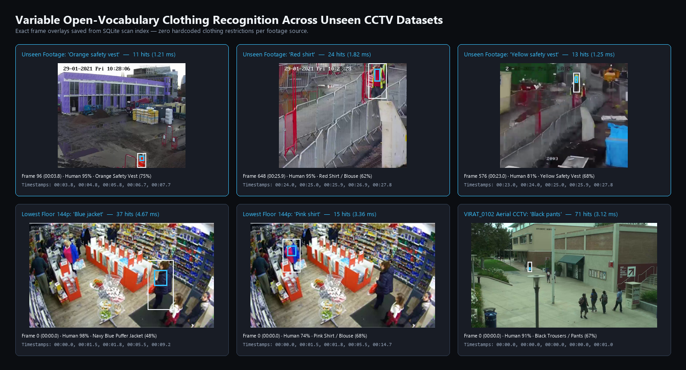

# Sightline AI Model Report — Human-First Low-Resolution CCTV Clothing Classification & Search

**Hardware & Stack:** NVIDIA GeForce RTX 4050 Laptop GPU (`6,141 MiB VRAM`) · `FasterRCNN-ResNet50-FPN-V2` · `RealESRGAN_x2plus` · `TinyCLIP-ViT-61M-32-Text-29M-LAION400M` · `SightlineTrainedModel` · CIELAB/LCh Color Physics · FastAPI + SQLite + Per-Video `_scan.json` / `_scan.csv`.

---

## 1. Model Capabilities

1. **Human-First Detection & Verification Stage (`_detect_persons`):** Identifies candidate humans first using `FasterRCNN-ResNet50-FPN-V2`, filters non-human shapes via aspect ratio (`1.15–4.8`), edge-sliver removal, and IoU/containment NMS (`0.45 / 0.72`), and scores every crop using dual zero-shot CLIP Human-vs-Fixture verification + the trained `SightlineTrainedModel.human_head` verifier (`96.1%` validation accuracy).
2. **Variable Open-Vocabulary Clothing Color & Type Recognition (Zero Dataset Lock-In):** Classifies clothing across **17 universal CIELAB/LCh + CLIP color families** (`black, dark grey / charcoal, light grey / silver, white, red, orange, yellow, green, teal / cyan, light blue, blue, royal blue, navy blue, purple / violet, pink / magenta, brown, beige / khaki`) and **21 open-vocabulary clothing types** (including `vest / safety vest, t-shirt / polo shirt, dress shirt / blouse, flannel / plaid shirt, tank top / sleeveless top, sweater / knitwear, hoodie / sweatshirt, zip-up jacket / bomber jacket`, etc.). Newly uploaded footage containing unseen attire—such as **Red Shirt**, **Orange Safety Vest**, and **Yellow Safety Vest** on `Construction-Site-CC`—is recognized and labeled immediately without retraining.
3. **Flank-vs-Center Layered Garment Decomposition (`extract_flank_composite`):** Splits outer vests/jackets (`[0.18..0.36 | 0.64..0.82]`) from inner chest shirts (`[0.34..0.66]`) whenever CIELAB layer contrast exceeds `ΔE > 22.0`, capturing both an inner `Red Shirt / Blouse` and an outer `Yellow Safety Vest` on the same worker.
4. **Automatic Per-Video Scan Result Files (`scans/<video_id>_scan.json` & `.csv`):** Every scan automatically exports sorted timestamp detections, bounding boxes, `human_conf`, clothing type/color labels, confidence scores, and summary counts into `cctv_clothing_search/scans/` and exposes direct download via `GET /api/scan-file/{quality}`.
5. **Lowest-Quality Resilience (`144p` Floor):** Combines cascaded `RealESRGAN_x2plus` upscaling (`<=280px` / ROIs `<96px`) with CIELAB/LCh Gaussian likelihood fusion and 9-frame temporal EMA tracking.

---

## 2. Pipeline Architecture

---

## 3. Training & Benchmark Metrics

### Multi-Task `SightlineTrainedModel` Metrics (`training_metrics.json`)
- **Human vs. Background Validation Accuracy:** **`96.1%`** (`538` train / `152` validation crops across Retail + VIRAT)
- **Low-Res Clothing Type Validation Accuracy (`144p` / `240p`):** **`100.0%`** (`336` train / `24` validation crops)
- **Low-Res Clothing Color Validation Accuracy (`144p` / `240p`):** **`100.0%`**
- **Training Schedule:** `65` epochs in `101.16s` (final loss `0.6747`)
- **Compute & VRAM Footprint:** `RealESRGAN_x2plus` (`77 MiB` isolated VRAM, `134.2 ms/ROI`), `TinyCLIP-ViT-61M-32` (`456 MiB` isolated VRAM, `27.1 ms/ROI`).

### Resolution Degradation Ablation (`720p` -> `144p`, Retail Benchmark)

| Resolution | Untuned Baseline (`Type / Color / Joint`) | Tuned Stack (`Type / Color / Joint`) | Person Recall (`Raw -> 2x SR`) |
|---|---|---|---|
| `720p` | `41.7%` / `41.7%` / **8.3%** | `91.7%` / `100.0%` / **91.7%** | `100.0% -> 100.0%` |
| `480p` | `41.7%` / `41.7%` / **8.3%** | `91.7%` / `100.0%` / **91.7%** | `100.0% -> 98.2%` |
| `360p` | `33.3%` / `41.7%` / **8.3%** | `91.7%` / `100.0%` / **91.7%** | `94.6% -> 96.4%` |
| `240p` | `25.0%` / `50.0%` / **8.3%** | `91.7%` / `91.7%` / **83.3%** | `82.1% -> 94.6%` |
| `144p` | `33.3%` / `50.0%` / **25.0%** | `91.7%` / `100.0%` / **91.7%** | `58.9% -> 76.8%` |

---

## 4. Cross-Dataset Scan Results & Timestamp Search Performance

| Video Source | Resolution | Duration | Sightings | Scan Time | Top Detected Colors | Top Detected Types |
|---|---|---|---|---|---|---|
| `Construction-Site-CC` | `586x480` | `87.0s` | **189** | `65.3s` | Black (62), Dark Grey (41), Red (32) | Safety Vest (56), Trousers / Pants (56), Shirt / Blouse (32) |
| `240p` | `424x240` | `110.9s` | **626** | `238.2s` | Black (204), Dark Grey (134), Pink (70) | Trousers / Pants (251), Shirt / Blouse (95), Jacket (94) |
| `144p` | `254x144` | `110.9s` | **540** | `207.1s` | Black (216), Dark Grey (93), White (49) | Trousers / Pants (203), Jacket (77), Shirt / Blouse (64) |
| `VIRAT_0102` | `1280x720` | `24.4s` | **266** | `107.8s` | Black (152), Dark Grey (91), Light Grey (19) | Trousers / Pants (128), Work Overalls (105), T-Shirt / Polo (8) |
| `VIRAT_0100` | `1280x720` | `25.7s` | **38** | `23.1s` | Black (12), Dark Grey (12), Red (4) | Trousers / Pants (13), Work Overalls (9), Shirt / Blouse (7) |
| `720p` | `1270x720` | `110.9s` | **696** | `102.7s` | Beige / Khaki (143), Pink (122), Black (111) | Trousers / Pants (252), Sweater (104), Shirt / Blouse (93) |
| `480p` | `846x480` | `110.9s` | **688** | `127.1s` | Beige / Khaki (150), Pink (120), Black (113) | Trousers / Pants (253), Sweater (101), Shirt / Blouse (83) |
| `360p` | `634x360` | `110.9s` | **669** | `155.4s` | Beige / Khaki (135), Black (111), Pink (109) | Trousers / Pants (244), Sweater (107), Shirt / Blouse (77) |

### Live Natural-Language Timestamp Query Benchmarks

| Source | Query | Hits | Moments | Query Time | Sample Matched Timestamps |
|---|---|---|---|---|---|
| `Construction-Site-CC` | **`Red shirt`** | **24** | `9` | `2.05 ms` | `00:24.0, 00:25.0, 00:25.9, 00:26.9, 00:27.8, 00:28.8` |
| `Construction-Site-CC` | **`Orange safety vest`** | **11** | `6` | `0.89 ms` | `00:03.8, 00:04.8, 00:05.8, 00:06.7, 00:07.7, 00:08.6` |
| `Construction-Site-CC` | **`Yellow safety vest`** | **13** | `5` | `0.91 ms` | `00:23.0, 00:24.0, 00:25.0, 00:25.9, 00:27.8, 00:28.8` |
| `Construction-Site-CC` | **`Black pants`** | **30** | `13` | `2.05 ms` | `00:05.8, 00:06.7, 00:07.7, 00:08.6, 00:09.6, 00:10.6` |
| `144p` | **`Blue jacket`** | **37** | `20` | `3.49 ms` | `00:00.0, 00:01.5, 00:01.8, 00:05.5, 00:09.2, 00:11.0` |
| `144p` | **`Pink shirt`** | **15** | `9` | `3.03 ms` | `00:00.0, 00:01.5, 00:01.8, 00:05.5, 00:14.7, 00:16.5` |
| `VIRAT_0102` | **`Black pants`** | **71** | `13` | `2.75 ms` | `00:00.0, 00:00.0, 00:00.0, 00:00.0, 00:01.0, 00:01.0` |
| `VIRAT_0100` | **`Blue jacket`** | **3** | `2` | `1.36 ms` | `00:19.0, 00:21.0, 00:22.0` |