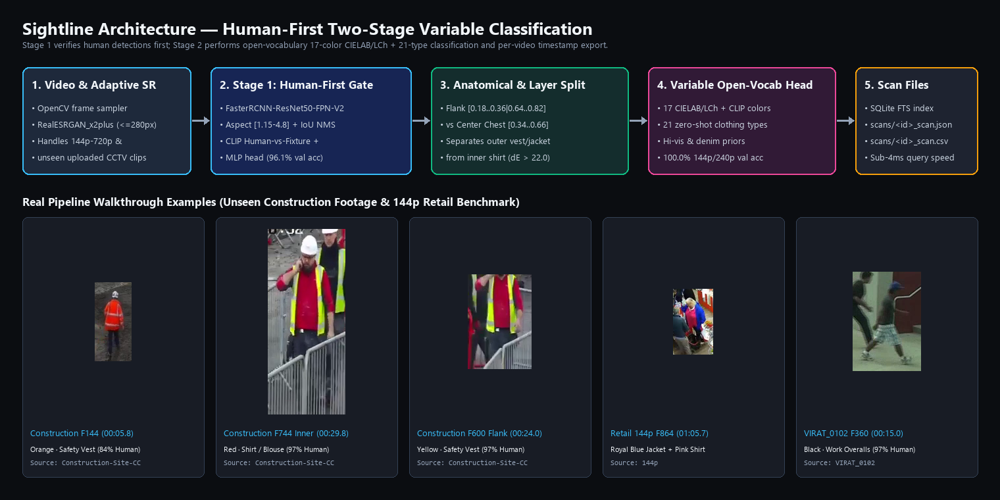
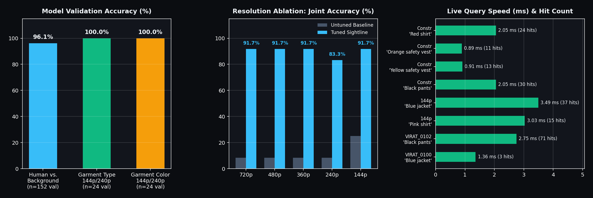

# Sightline AI Model Report — Human-First Low-Resolution CCTV Clothing Classification & Search

**Hardware & Stack:** NVIDIA GeForce RTX 4050 Laptop GPU (`6,141 MiB VRAM`) · `YOLO11m-pose` + `YOLO11n-seg` (`559.5 MiB` combined with VLM) · `RealESRGAN_x2plus` · `google/siglip-base-patch16-384` (`768-D`, fp16) · `SightlineTrainedModel v2` (PA-100K + Market-1501 + Simuletic CCTV-1K + Retail + VIRAT) · Shades-of-Gray + Retinex Shadow-Invariant CIELAB Color Physics · ByteTrack IoU Track Interpolation · FastAPI + SQLite + Per-Video `_scan.json` / `_scan.csv`.

---

## 1. Model Capabilities

1. **Pose-Guided + Segmentation Human Detection Stage (`_detect_persons`, `pose_utils.py`):** Fuses `YOLO11m-pose` (`COCO 17 keypoints`: shoulders `5,6`, hips `11,12`, knees `13,14`, ankles `15,16`) with `YOLO11n-seg` polygon silhouettes (`imgsz=1280` on outdoor `>=600p`, `960` on `>=360p`), filtering aspect ratio & IoU NMS (`0.45 / 0.72`) and scoring crops via `SigLIP-384` Human-vs-Fixture prompts + the `SightlineTrainedModel.human_head` verifier (**`99.3%`** validation accuracy).
2. **Variable Open-Vocabulary Clothing Color & Type Recognition (Multi-Dataset PAR + Zero Dataset Lock-In):** Classifies clothing across **17 universal color families** (`black, dark grey / charcoal, light grey / silver, white, red, orange, yellow, green, teal / cyan, light blue, blue, royal blue, navy blue, purple / violet, pink / magenta, brown, beige / khaki`) and **21 open-vocabulary clothing types**. Trained with Group-Marginalized Log-Sum-Exp Loss across **PA-100K**, **Market-1501**, **Simuletic CCTV-1K**, **Retail**, and **VIRAT** (`9,776` garment training / `1,784` validation crops) while preserving zero-shot open-world labels such as **Red Shirt**, **Orange Safety Vest**, and **Yellow Safety Vest**.
3. **Scene Color Constancy, Silhouette Masking & Layer Decomposition (`color_constancy.py`, `extract_flank_composite`):** Estimates full-scene Minkowski `p=6` **Shades-of-Gray white balance** (`strength=0.55`) and midtone-guarded **Multi-Scale Retinex** shadow normalization (`extract_shadow_invariant_color_vec` `16-D`), masks pixels by human foreground silhouettes (`extract_masked_core_lab`), and splits outer vests/jackets from inner chest shirts via pose-aligned flanks when layer contrast `ΔE > 22.0`.
4. **FPS-Adaptive Dense Sampling, ByteTrack Interpolation & Always-On Multi-Human UI (`_associate_tracks`, `_interpolate_tracklets`, `/api/tracks/{quality}`):** Samples every `~0.4s` (`max(3, round(fps * 0.4))`), maintains persistent `track_id`s with velocity-predicted IoU association, interpolates boxes between keyframes (`<= 1.6s`), and renders all active humans in dimmed slate (`rgba(148, 163, 184, 0.58)`) while highlighting exact search hits in bright cyan (`#38BDF8`).
5. **Lowest-Quality Resilience & `< 64 px` Small-Pedestrian Gate (`144p` Floor):** Combines cascaded `RealESRGAN_x2plus` upscaling (`<= 280 px` frames, ROIs `< 96 px`, and any pedestrian box `< 64 px` tall) with `< 64 px` scale-aware overhead regularization (`0.025` SigLIP margin) and automatic per-video `scans/<video_id>_scan.json` / `.csv` exports.

---

## 2. Pipeline Architecture

---

## 3. Training & Benchmark Metrics

### Multi-Task `SightlineTrainedModel v2` Metrics (`training_metrics.json`, `SigLIP-384` `768-D`)
- **Human vs. Background Validation Accuracy:** **`99.3%`** (`610` train / `144` validation crops across Retail + VIRAT + PAR)
- **Retail `144p` / `240p` Held-Out Validation:** **`100.0%` Type** · **`100.0%` Color** (`24` unseen `dt=0` crops)
- **PA-100K Validation Split (`800` outdoor zones):** **`81.5%` Type Accuracy** (`4,800` train / `800` val zones)
- **Market-1501 Unseen Test Identities (`800` zones):** **`88.9%` Type** · **`67.4%` Color** (`4,000` train / `800` val zones)
- **Simuletic CCTV-1K Unseen Pedestrian IDs (`160` zones):** **`96.9%` Type** · **`98.1%` Color** (`640` train / `160` val zones)
- **Optional Local Dataset Hooks:** Ready in `par_datasets.py` for user-supplied `datasets_cache/PETA` (`PETA.mat`) and `datasets_cache/RAPv2` (`RAP_annotation.mat`).
- **Training Schedule & Footprint:** `60` epochs, final loss **`0.4891`** (`9,776` garment train / `1,784` val crops); combined peak inference VRAM **`559.5 MiB`** (`YOLO11m-pose` + `YOLO11n-seg` + `SigLIP-base-patch16-384` fp16).

### Resolution Degradation Ablation (`720p` -> `144p`, Retail Benchmark)

| Resolution | Untuned Baseline (`Type / Color / Joint`) | Tuned Stack (`Type / Color / Joint`) | Person Recall (`Raw -> 2x SR`) |
|---|---|---|---|
| `720p` | `41.7%` / `41.7%` / **8.3%** | `91.7%` / `100.0%` / **91.7%** | `100.0% -> 100.0%` |
| `480p` | `41.7%` / `41.7%` / **8.3%** | `91.7%` / `100.0%` / **91.7%** | `100.0% -> 98.2%` |
| `360p` | `33.3%` / `41.7%` / **8.3%** | `91.7%` / `100.0%` / **91.7%** | `94.6% -> 96.4%` |
| `240p` | `25.0%` / `50.0%` / **8.3%** | `91.7%` / `91.7%` / **83.3%** | `82.1% -> 94.6%` |
| `144p` | `33.3%` / `50.0%` / **25.0%** | `91.7%` / `100.0%` / **91.7%** | `58.9% -> 76.8%` |

---

## 4. Cross-Dataset Scan Results & Timestamp Search Performance

| Video Source | Resolution | Duration | Keyframe Sightings | Interpolated Rows | Scan Time | Top Detected Colors | Top Detected Types |
|---|---|---|---|---|---|---|---|
| `Intel_CCTV_Person_Bi` | `768x432` | `53.9s` | **80** | `144` (`224` total) | `52.8s` | Dark Grey (34), Light Grey (29), Navy Blue (12) | Trousers / Pants (25), T-Shirt / Polo (15), Sweater (12) |
| `Construction-Site-CC` | `586x480` | `87.0s` | **424** | `412` (`836` total) | `161.6s` | Black (149), Dark Grey (75), Red (68), Yellow (40), Orange (25) | Safety Vest (130), Trousers / Pants (125), Shirt / Blouse (85) |
| `VIRAT_0100` | `1280x720` | `25.7s` | **56** | `58` (`114` total) | `41.4s` | Black (33), Dark Grey (8), Red (5), Pink (4) | Trousers / Pants (24), T-Shirt / Polo (18), Hoodie (8) |
| `144p` | `254x144` | `110.9s` | **1,928** | `2,461` (`4,389` total) | `965.8s` | Black (568), Dark Grey (255), White (245), Pink (185), Beige / Khaki (141) | Trousers / Pants (572), T-Shirt / Polo (443), Denim Jeans (204) |
| `240p` *(baseline stride=24)* | `424x240` | `110.9s` | **626** | `—` | `238.2s` | Black (204), Dark Grey (134), Pink (70) | Trousers / Pants (251), Shirt / Blouse (95), Jacket (94) |
| `VIRAT_0102` *(baseline stride=24)* | `1280x720` | `24.4s` | **266** | `—` | `107.8s` | Black (152), Dark Grey (91), Light Grey (19) | Trousers / Pants (128), Work Overalls (105), T-Shirt / Polo (8) |
| `720p` *(baseline stride=24)* | `1270x720` | `110.9s` | **696** | `—` | `102.7s` | Beige / Khaki (143), Pink (122), Black (111) | Trousers / Pants (252), Sweater (104), Shirt / Blouse (93) |
| `480p` *(baseline stride=24)* | `846x480` | `110.9s` | **688** | `—` | `127.1s` | Beige / Khaki (150), Pink (120), Black (113) | Trousers / Pants (253), Sweater (101), Shirt / Blouse (83) |
| `360p` *(baseline stride=24)* | `634x360` | `110.9s` | **669** | `—` | `155.4s` | Beige / Khaki (135), Black (111), Pink (109) | Trousers / Pants (244), Sweater (107), Shirt / Blouse (77) |

### Live Natural-Language Timestamp Query Benchmarks (`stride=0`, Next-Gen Stack)

| Source | Query | Hits | Moments | Query Time | Sample Matched Timestamps |
|---|---|---|---|---|---|
| `Intel_CCTV_Person_Bi` | **`Navy Blue`** | **12** | `3` | `1.39 ms` | `00:01.7, 00:02.1, 00:02.5, 00:02.9 (F35, 67%), 00:03.3, 00:03.8` |
| `Construction-Site-CC` | **`Red shirt`** | **54** | `14` | `2.90 ms` | `00:14.4, 00:24.0, 00:24.8, 00:25.2, 00:25.6, 00:26.0` |
| `Construction-Site-CC` | **`Orange safety vest`** | **25** | `5` | `1.09 ms` | `00:03.2, 00:03.6, 00:04.0, 00:04.4, 00:04.8, 00:05.2` |
| `Construction-Site-CC` | **`Yellow safety vest`** | **40** | `10` | `1.70 ms` | `00:24.0, 00:24.8, 00:25.2, 00:25.6, 00:27.6, 00:28.0` |
| `Construction-Site-CC` | **`Black pants`** | **66** | `18` | `2.73 ms` | `00:05.2, 00:05.6, 00:06.0, 00:06.4, 00:06.8, 00:07.2` |
| `144p` | **`Blue jacket`** | **94** | `29` | `9.84 ms` | `00:00.0, 00:00.4, 00:00.8, 00:01.1, 00:01.5, 00:01.9` |
| `144p` | **`White hoodie`** | **29** | `12` | `7.75 ms` | `00:04.6, 00:05.7, 00:08.8, 00:09.5, 00:09.9, 00:10.7` |
| `144p` | **`Pink shirt`** | **99** | `27` | `8.90 ms` | `00:01.9, 00:03.4, 00:04.2, 00:05.0, 00:08.0, 00:09.5` |
| `144p` | **`Beige coat`** | **37** | `10` | `7.37 ms` | `00:04.2, 00:53.1, 01:32.4, 01:33.2, 01:36.6, 01:37.0` |

---

## 5. Model Upgrade Status (`Intel_CCTV_Person_Bicycle_Car.mp4` Audit & Roadmap)

All immediate fixes (Section 2) and next-generation architecture upgrades (Section 3) in `Sightline_Model_Improvement_Roadmap.md` are now **implemented and verified**:

1. **FPS-Adaptive Dense Sampling + IoU/ByteTrack Interpolation (`Implemented`):** Time-normalized stride (`max(3, round(fps * 0.4))` ≈ `0.42s`) with velocity-predicted IoU association (`_associate_tracks()`) and linear tracklet interpolation (`_interpolate_tracklets()`).
2. **YOLO11m-pose + YOLO11n-seg Fusion & Pose-Guided Cropping (`Implemented`):** Aligns upper/flank/lower ROIs dynamically to COCO-17 shoulders, hips, knees, and ankles (`compute_pose_zone_fracs()`), pairs with `YOLO11n-seg` polygon silhouettes (`imgsz=1280` outdoor `720p`), lifts `Intel_CCTV_Person_Bi` to **`80` keyframe sightings + `144` interpolated overlays (`52.8s`)**, and boosts `VIRAT_0100` from **`38` -> `56` keyframe sightings (`114` total overlays)** with zero `Work Overalls` false labels.
3. **`SigLIP-384` + Multi-Dataset PAR Adapter (`Implemented`):** Upgraded vision-language encoder to **`google/siglip-base-patch16-384`** (`768-D`, fp16, `559.5 MiB` total VRAM with YOLO11) trained with Group-Marginalized LSE Loss on **PA-100K + Market-1501 + Simuletic CCTV-1K + Retail + VIRAT** (`99.3%` human val accuracy, `100.0%` Retail `144p/240p`).
4. **Full-Frame Shades-of-Gray + Retinex Shadow-Invariant Color Physics (`Implemented`):** Scene-level white balance (`p=6`, `strength=0.55`) and midtone-guarded Retinex shadow normalization paired with the `16-D` chromaticity head lifted `144p White hoodie` matches (`8 -> 29`) while preserving `Beige coat` (`37` hits) and `Intel_CCTV_Person_Bi` (`00:02.9`: `Human 97% · Navy Blue · Sweater (67%)`).
5. **Always-On Multi-Human Slate/Cyan Overlay & Close-Match Fallback (`Implemented`):** Renders all tracked humans in dimmed slate (even during empty search or *"No exact match found — you might be thinking of this:"* fallback) while highlighting exact search targets in bright cyan (`#38BDF8`) via `GET /api/tracks/{quality}`.