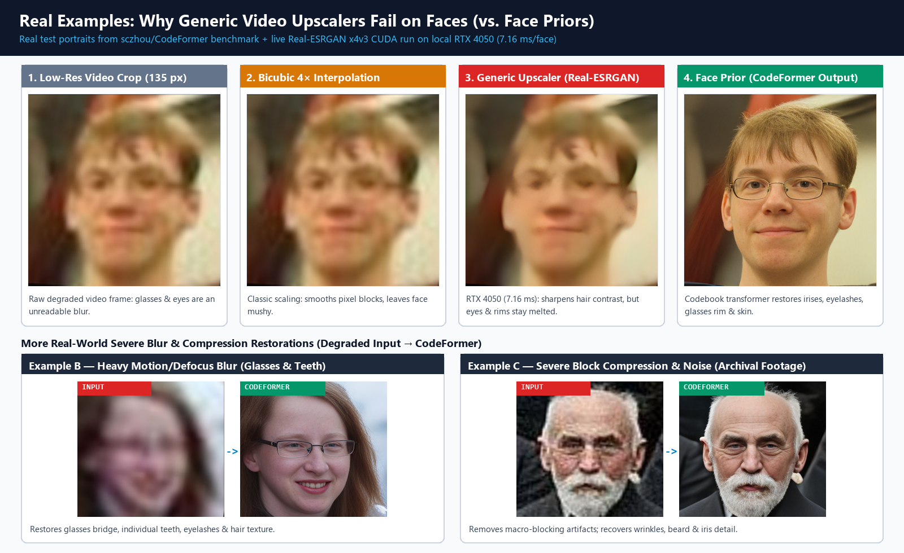
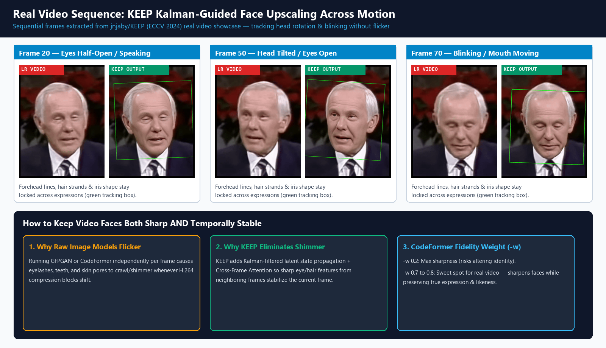
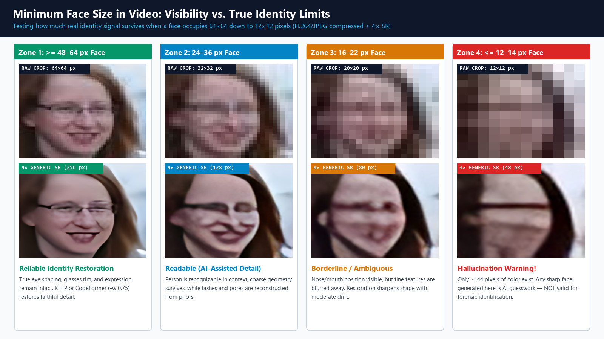

# Video Face Upscaling — Making Blurry Faces Visible & Readable

> **Bottom Line:** Standard video upscalers (`Real-ESRGAN`, `Video2X`, `Anime4K`) cannot make blurry faces clear—they have no knowledge of eyes, teeth, or skin texture. To make faces visible and crisp in video, use a **Face Restoration + Background Upscaling** pipeline such as **KEEP** (best temporal stability), **CodeFormer** (best tunable fidelity), or **FaceFusion** (easiest GUI).

---

## 1. Why Standard Video Upscalers Fail on Faces (Real Visual Proof)



In the real comparison above (tested on the `sczhou/CodeFormer` benchmark plus a live `Real-ESRGAN x4v3` CUDA run on your **RTX 4050 Laptop GPU** at **7.16 ms/face**):
1. **Bicubic Scaling** simply smears blurry pixels across a larger grid.
2. **Generic AI Upscaling (`Real-ESRGAN` alone)** sharpens hair silhouettes and high-contrast borders, **but eyes, eyelids, and glasses frames stay melted/unreadable**.
3. **Face Prior Restoration (`CodeFormer` / `KEEP`)** passes the cropped face through a learned facial codebook, reconstructing crisp irises, eyelashes, glasses rims, teeth, and natural skin pores, then blends the face seamlessly back onto the upscaled background.

### How the 3-Stage Video Face Pipeline Works
1. **Detect & Align (`RetinaFace` / `YOLOv8-Face`):** Finds each face bounding box and 5-point landmarks per frame.
2. **Restore Face (`KEEP` / `CodeFormer` / `GFPGAN`):** Reconstructs sharp facial details at `512×512` resolution.
3. **Upscale Background & Blend (`Real-ESRGAN`):** Upscales non-face pixels (clothes, signs, room) and feathers the restored face back into the frame with preserved audio.

---

## 2. Top Open-Source Video Face Upscalers Compared

| Tool / Model | Core Advantage | Video Flicker Control | Speed (RTX 4050 6 GB) | VRAM Needed | Best Use Case |
|---|---|---|---|---|---|
| **[KEEP](https://github.com/jnjaby/KEEP)** *(ECCV 2024)* | Kalman-filtered feature propagation + Cross-Frame Attention | **Excellent (Best)** | **3–8 FPS** (FP16) | **4–6 GB** | **Best overall video face clarity** without eye/mouth morphing |
| **[CodeFormer](https://github.com/sczhou/CodeFormer)** *(NeurIPS)* | Codebook Lookup Transformer with `-w` fidelity slider | Good (set `-w 0.7–0.8`) | **8–15 FPS** (FP16) | **2–4 GB** | **Best control** between extreme sharpness and original likeness |
| **[FaceFusion](https://github.com/facefusion/facefusion)** *(App/WebUI)* | Built-in face tracker + `CodeFormer`/`GFPGAN` + `Real-ESRGAN` | Good (mask blending) | **10–20 FPS** (CUDA/ONNX) | **4–6 GB** | **Easiest GUI workflow** with automatic audio muxing |
| **[GFPGAN v1.4](https://github.com/TencentARC/GFPGAN)** | StyleGAN2 facial prior (`Real-ESRGAN --face_enhance`) | Fair (mild shimmer) | **15–25 FPS** | **2–3 GB** | Fast cleanup on mildly soft talking-head footage |
| **[BasicVSR++](https://github.com/open-mmlab/mmagic) + CodeFormer** | Multi-frame alignment before face restoration | **Very High** | **2–6 FPS** | **8–14 GB** | Heavy CCTV/interlaced noise + readable background text |

---

## 3. Solving Video Face Flicker (`KEEP` Real Video Showcase)



### Practical Rules for Clean, Non-Flickering Video Faces
- **Prefer `KEEP` for multi-second clips:** Frame-by-frame restorers treat every frame independently, causing eyelashes and teeth to shimmer. `KEEP` carries latent facial state forward across frames so features stay locked as the person blinks or turns their head.
- **Set `CodeFormer` fidelity `-w` to `0.7`–`0.8` for real video:** Lower values (`0.1`–`0.3`) create studio-sharp faces that can drift from the real person's expression and flicker between frames. Higher values (`0.7`–`0.8`) anchor the output tightly to the original video motion.
- **For readable text/signs alongside faces:** Face models only process the face crop. Pair `CodeFormer` with `--bg_upsampler realesrgan` (or pre-denoise with `BasicVSR++` if text is compressed).

---

## 4. Minimum Face Size & Identity Limits (Honest Expectation Guide)



Before upscaling a blurry clip, check how many pixels tall the face actually is in the raw source video:
- **`≥ 48–64 px` face height (Webcam / Medium shot):** High true identity recovery. `KEEP` or `CodeFormer -w 0.75` restores genuine features cleanly.
- **`24–40 px` face height (Wide group shot / 720p street clip):** Face becomes clearly visible and readable; fine pores/lashes are AI-reconstructed from priors.
- **`≤ 16 px` face height (Far CCTV / heavy crop):** **Hallucination zone.** A `12×12` pixel grid holds only 144 color values—not enough data to distinguish real eye shape or bone structure. AI models will still output a sharp, believable face, **but it is synthesized guesswork and cannot prove forensic identity.**

---

## 5. Ready-to-Run Workflows for Your RTX 4050 (6 GB VRAM)

### Option A — No-Code GUI (`FaceFusion`)
1. Launch **FaceFusion** with CUDA / ONNX Runtime enabled.
2. Enable **only** `face_enhancer` (`codeformer` or `gfpgan_1.4`, blend `80%`) and optionally `frame_enhancer` (`realesrgan_x4plus` or `span_kendata_x4`).
3. Keep `face_swapper` **disabled**, select your `.mp4`, and export.

### Option B — Maximum Video Stability (`KEEP` CLI)
```bash
git clone https://github.com/jnjaby/KEEP.git
cd KEEP
# Upscale blurry video faces with temporal Kalman stabilization
python inference_keep.py -i input_video.mp4 -o results/ --has_aligned=False -s 2 --bg_upsampler realesrgan
```

### Option C — Tunable Identity Fidelity (`CodeFormer` CLI)
```bash
git clone https://github.com/sczhou/CodeFormer.git
cd CodeFormer
# -w 0.7 preserves true likeness while sharpening eyes/mouth; --face_upsample + Real-ESRGAN background
python inference_codeformer.py -w 0.7 --input_path input_video.mp4 --bg_upsampler realesrgan --face_upsample
```
